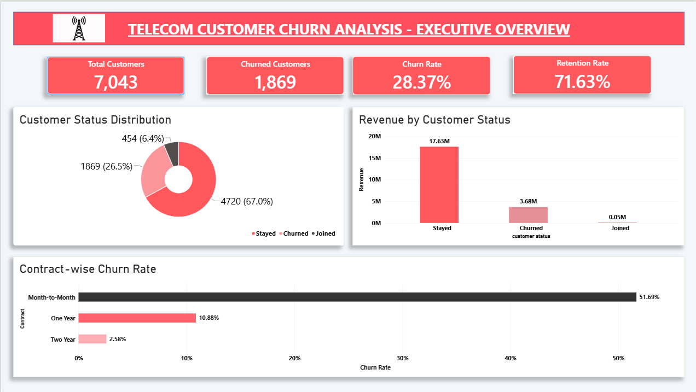
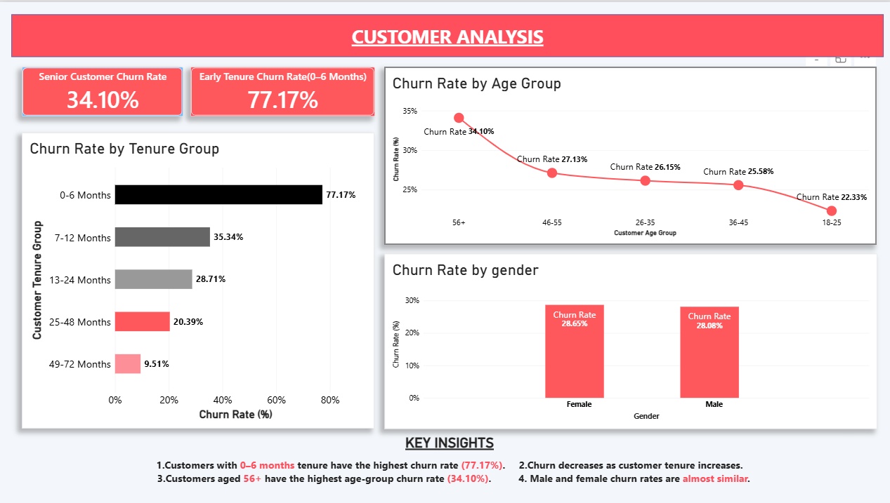
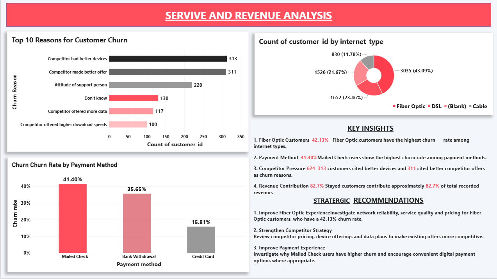

# 📊 Telecom Customer Churn Analysis Project

## 📌 Project Overview

Customer churn is one of the major challenges faced by telecom companies. Losing customers affects business revenue, customer retention, and long-term growth.

This project analyzes telecom customer data to understand churn patterns, customer behavior, service preferences, and revenue distribution.

🎯 **Goal:** Identify high-risk customer segments and understand the key factors influencing customer churn.

---

## ❗ Problem Statement

Telecom companies face challenges in retaining customers due to competition, pricing, service quality, and customer experience.

Without proper analysis, it becomes difficult to identify which customers are more likely to leave and what factors contribute to churn.

**Objective:** Analyze customer churn patterns, identify high-risk customer segments, evaluate revenue contribution, and provide data-driven recommendations to improve customer retention.

---

## 📂 Dataset

- 📌 **Source:** Telecom Customer Churn Dataset(Maven Analytics)
- 📊 **Records:** 7,043 rows
- 📑 **Columns:** 38
- 👥 **Existing Customers:** 6,589
- ⚠️ **Churned Customers:** 1,869
- 🌐 **Coverage:** Customer demographics, tenure, contracts, services, payment methods, and revenue

---

## 🛠️ Tools & Technologies

| **Tool**                  | **Purpose**                               |
| ------------------------- | ----------------------------------------- |
| 🐍 Python (Pandas, NumPy) | Data cleaning & preprocessing             |
| 🐘 PostgreSQL             | Business question analysis (SQL)          |
| 📊 Power BI (DAX)         | Interactive dashboards & visualizations   |
| 💻 Git & GitHub           | Version control and project documentation |

---

## 🔄 Methodology

1. 🧹 **Data Cleaning** — Removed duplicates, handled missing values, standardized column names, and prepared the dataset using Python.
2. 🗄️ **Database Management** — Loaded the cleaned customer data into PostgreSQL.
3. 🔍 **SQL Analysis** — Developed 10 business questions to analyze customer status, churn, contracts, tenure, payment methods, services, and revenue.
4. 📈 **Dashboard Development** — Created a 3-page Power BI report with KPI cards, charts, DAX measures, and business insights.
5. 💡 **Business Recommendations** — Identified high-risk customer segments and suggested strategies to improve customer retention.

---

## 🔑 Key Insights

1. 📊 **Overall Churn Rate** — 28.37% of existing customers have churned, while the retention rate is 71.63%.
2. 📄 **Month-to-Month Contracts** — Customers with month-to-month contracts have the highest churn rate at 51.69%, compared to only 2.58% for two-year contracts.
3. ⏳ **Early Tenure Risk** — Customers within their first 6 months have a very high churn rate of 77.17%. Churn decreases as customer tenure increases.
4. 🌐 **Fiber Optic Churn** — Fiber Optic customers have the highest internet-type churn rate at 42.13%, indicating a need to investigate service quality and customer experience.
5. 💳 **Payment Method Analysis** — Mailed Check customers have the highest churn rate at 41.40%, while Credit Card customers have the lowest at 15.81%.
6. 👥 **Age Group Analysis** — Customers aged 56+ have the highest churn rate at 34.10%, compared to 22.33% among customers aged 18–25.
7. 💰 **Revenue Contribution** — Stayed customers contribute approximately 82.7% of total recorded revenue, amounting to 17.63 million dataset units.
8. 🏆 **Top Churn Reasons** — Competitor-related reasons dominate: better devices (313 customers) and better offers (311 customers). Support staff attitude is another major reason (220 customers).

--

## 📸 Dashboard Preview

### 1. 📊 Executive Overview

High-level business performance, customer status distribution, churn rate, retention rate, and revenue analysis.



### 2. 👥 Customer Analysis

Customer demographics, age group-wise churn, tenure group-wise churn, and gender-wise churn analysis.



### 3. 💰 Service & Revenue Analysis

Internet service churn, payment method analysis, top churn reasons, and revenue contribution.



---

## 📁 Project Structure
```
Telecom_Customer_Churn_Analysis/
│
├── 📂 data/
│   ├── raw/
│   └── processed/
│
├── 📂 python/
│   └── data_cleaning.py
│
├── 📂 sql/
│   └── telecom_churn_analysis.sql
│
├── 📂 powerbi/
│   ├── Telecom_Churn_Dashboard.pbix
├──📂screenshots/
├──📄 README.md
```

---

## 💡 Business Recommendations

- 🎯 Improve onboarding and customer engagement during the first six months.
- 📄 Encourage suitable long-term contracts through attractive offers.
- 🌐 Investigate Fiber Optic service quality, pricing, and customer complaints.
- 💳 Understand the reasons behind higher churn among mailed-check customers.
- 🏆 Monitor competitor pricing, devices, and data offers.
- 🤝 Improve customer support training and complaint resolution.

---

## 🚀 Future Improvements

- 🤖 Develop a Machine Learning model to predict customer churn.
- 🎯 Build customer risk segmentation.
- 🔄 Automate data refresh and reporting workflows.
- 📊 Add customer lifetime value (CLV) analysis.

---

## Author

**Prasanna Ringole**\
📧 [ringoleprasanna13@gmail.com](mailto:khushivrao61@gmail.com)
